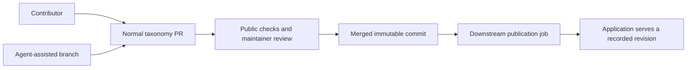

# Taxonomy authoring and downstream publication

**Date:** 3 November 2026

**Status:** Proposed design for community review. The optional [alignment preparation contract](curriculum-alignment-contract.md) implements the first schema/tooling step. The target workflow, contribution requirements and downstream authority switch are not activated by that preparation work.

## Decision

Reviewed commits on this repository's protected default branch become the authority for the shared taxonomy. A downstream application deploys a recorded commit and retains ownership of its private records and operational state. An authoring agent's workspace holds drafts and notes.

A PR reviews and accepts the actual change. Community contributors and agent-assisted maintainers use the same contribution path. There is no mandatory internal change-set file, private account, second semantic acceptance process or application-code PR for a routine curriculum update. A downstream deployment failure does not undo acceptance in this repository.

This is the canonical design for shared ownership, public representation, contribution and the downstream publisher contract. Consumers document their own storage, transactions, authentication and cutover procedures separately; those details do not redefine repository acceptance.



## Contributor experience

1. Edit public taxonomy files in a branch.
2. Run public validation and generation commands locally, without DB credentials.
3. Open a PR containing the real diff, address feedback and merge.
4. Downstream consumers deploy the accepted commit through their own maintenance processes.

Generated compatibility data and checksums are prepared within that PR, using a local command or bot assistance. A second release PR must not be required to accept the same semantic change. CI should present authored changes separately from generated numeric/checksum churn while reporting the complete derived impact.

Normal Git conflicts are resolved in the PR, and checks rerun against the combined merge candidate. A consumer may need an upgrade for a new schema; that is a consumer deployment concern. Contributors need no knowledge of private database schemas or access to private learner records. Preserve contributor attribution and PR/commit provenance when agents or services prepare and deploy changes.

## Ownership

| Content | Authority |
| --- | --- |
| Stable topic IDs, types, names, descriptions, evidence and assessment questions | Reviewed repository content |
| Dependencies and complete public curriculum alignments | Reviewed repository content |
| Public source identities, codes, links, coverage reports, guidance and cluster summaries | Reviewed repository content, subject to source publication policy |
| Global bounds, flat standard lists, centrality, counts and checksums | Versioned deterministic computation over the repository snapshot |
| Restricted source wording, private research originals, embeddings and private application records | The relevant consumer/private system |
| A consumer's applied-commit pointer and deployment receipt | That consumer's maintenance system |

`taxonomyVersion`, such as `v1`, identifies a taxonomy namespace. A Git commit identifies a content revision within it. Releasing a revision does not allocate replacement IDs for all existing topics. New IDs can be generated locally once, retained in the branch and checked for uniqueness in CI.

Missing public fields do not mean deletion of private fields. Consumers must define a field mapping and preserve private information. They must not reconstruct richer records by treating the current export as a complete database replacement.

## Complete public alignment format

The existing [topic schema](../schema/topics.schema.json) exposes global age bounds and a flat `standards` list. Some authoring context is currently retained outside that projection. Before cutover, the public format must represent all shared country/region-specific ages and standard associations losslessly.

The optional preparation [schemas, contract and read-only tools](curriculum-alignment-contract.md) describe the proposed `data/curriculum-alignments.json`. [Schema version 2](curriculum-alignment-contexts-v2.md) separates global guidance, international framework associations and jurisdiction-specific mappings while preserving per-association age intervals. The published dataset has not been backfilled; the authority switch and complete artifact generator remain future work. This separate file avoids immediately adding unsupported properties to the existing strict topic schema. An illustrative version 2 record is:

```json
{
  "topicId": "mt_gvU3c_FLyu",
  "scope": "jurisdiction",
  "country": "CA",
  "region": "Ontario",
  "ageRangeStart": 11,
  "ageRangeEnd": 12,
  "standards": [
    "the-ontario-curriculum-language-2023:ON-LANG-2023-G6-B3.3"
  ]
}
```

The schema must specify region normalization, uniqueness, age bounds, standard membership and intentional age-only contexts. Complete contexts must not be inferred from global bounds. Standard keys identify a curriculum slug and code, rather than a code or title alone. Internal DB UUIDs are resolved by consumers and are not contributor inputs.

Existing flat standard lists and global bounds remain available as generated compatibility fields. CI rejects disagreement with the authored alignment records. A public generation command updates these fields, counts and checksums without a private catalogue connection.

Baseline reconciliation must document unresolved source references and preserve their country/age semantics. It must not silently discard context, guess source mappings or promote unverified coverage to Full. Private historical metadata can remain private, with an explicit disposition that does not leave shared active semantics dependent on an unpublished record.

## Validation and review

Reuse the existing [integrity validator](../scripts/validate.mjs), [schema checker](../scripts/check-schema.mjs), schemas and regression tests. Extend them with the complete alignment contract and deterministic generation checks.

Mechanical checks cover IDs, reference resolution, schemas, DAGs, generated-field agreement, checksums and explicit coverage conditions. They cannot certify pedagogical truth or learner mastery. Maintainers review:

- Whether the whole claim can be reused or a distinct claim is required.
- Whether description, evidence, assessment question and examples agree.
- Positive, near-miss and cross-context assessment cases.
- Whole-expectation, component and prerequisite contributions.
- Resource/performance conditions that keep coverage Partial.
- Stable identity and the impact of changing mastery meaning, merging or retiring topics.

A topic–code link alone does not establish Full coverage. Country-specific examples must not create unnecessary duplicate topics or difficulty tiers. Existing [contribution principles](../README.md#adding-curricula) continue to apply.

Validation reports name the checks actually performed. Missing inputs, unsupported fields/contracts and stale passing results must fail closed. Keep learner data, private audit snapshots and protected aggregate values out of the repository. Retain the publication rules in [PROVENANCE.md](../PROVENANCE.md); this proposal does not expand redistribution rights.

## Deterministic artifacts and revision identity

Use an explicit schema/generator contract and canonical semantic digest: stable record ordering, preserved text and evidence order, and documented treatment of generated metadata. Wall-clock timestamps must not create semantic changes on every check. Downstream publishers validate with a pinned, supported implementation.

A manifest contained in a commit cannot embed that commit's own SHA. Repository metadata can contain the payload digest. A consumer records the full commit SHA in its deployment receipt; external release metadata can add that SHA after the commit exists.

The repository contains the accepted data and compatibility artifacts. After cutover, a downstream DB export must not automatically overwrite them. Diagnostic comparisons or proposals to correct the dataset still go through normal review.

## Agent-assisted authorship

An agent edits a branch, runs the public checks and opens or updates an ordinary PR. It can build a disposable graph for traversal and analysis, cached by snapshot digest. Its read/edit tools must identify the branch or working tree being examined and distinguish draft changes from downstream deployment.

Notes and checkpoints can remember decisions, branch names, PRs and job references. Accepted content remains durable in Git even if an agent stops, loses context or is replaced. Multiple agents use separate branches. No agent process must stay alive for an accepted commit to deploy.

An agent can read restricted source material through an authorized consumer tool, but must preserve the public-field and source-publication policy when writing a branch. It has no special route to change the accepted public taxonomy outside repository review.

## Downstream publisher contract

A consumer may follow accepted main automatically, promote selected accepted commits, or pause deployment. Deployment status is separate from repository acceptance. It should expose the requested commit, applied commit, supported contract and actual outcome without publishing private records.

A publisher must:

- Pin an immutable accepted commit and verify its repository, ancestry, schema and payload digest.
- Parse allowlisted data with trusted deployed code; privileged jobs must not execute contributor scripts or expose credentials to fork CI.
- Resolve public source keys within each environment and apply only explicitly owned fields.
- Preserve stable IDs and private records, preparing required derived work before activation.
- Record a complete application revision and durable outcome, including retries after lost responses or worker restarts.
- Keep the previous working revision active when preparation or activation fails.
- Reject stale ordering, unexplained DB drift and unsupported changes visibly.

The receipt should identify the repository/commit, namespace, environment, payload/contract, validation performed and deployment outcome. It should support recognizing a completed retry. The consumer chooses the implementation that makes its activation and receipt agree; no particular private database layout is part of this public design.

A public merge does not implicitly authorize learner resets. A consumer can block deployment while handling an incompatible mastery change or migration, without requiring contributors to access private state or repeat public acceptance. Reverts are new reviewed commits; they do not restore private records from a taxonomy backup.

## Migration and next step

The first milestone is a **read-only authoring-contract and baseline audit**:

1. Propose the complete alignment schema, fixtures and public normalization/generation rules.
2. Compare the published projection with existing authoring contexts and document missing information.
3. Produce a reviewed baseline proposal and explicit dispositions for unresolved references.
4. Demonstrate that a consumer can map the snapshot to its shared fields without losing private data. Incomplete or lossy conversion exits nonzero.

This milestone performs no live writes or authority switch. It establishes the boundary needed for a safe publisher.

Subsequent milestones add publication/status implementations, Git-backed agent tools, failure tests and a controlled cutover. Consumers must disable legacy authoritative writers before enabling the new path. Existing backups remain historical records.

Before declaring the transition complete, demonstrate one-PR contribution without private credentials; reproducible compatibility artifacts; complete alignment fidelity; preserved IDs and attribution; recoverable deployment; and independent agent shutdown. Schema/generator changes and genuine application behavior changes can require consumer-code PRs. Routine curriculum changes should not.

Open design details are the alignment schema and compatibility policy, baseline reference dispositions, digest/generator contract and evidence required for impact classifications. These should be discussed through this repository's normal review. Consumer-specific transaction limits, internal tables, authentication and cutover mechanics belong in consumer implementation plans and do not add a second community acceptance process.
